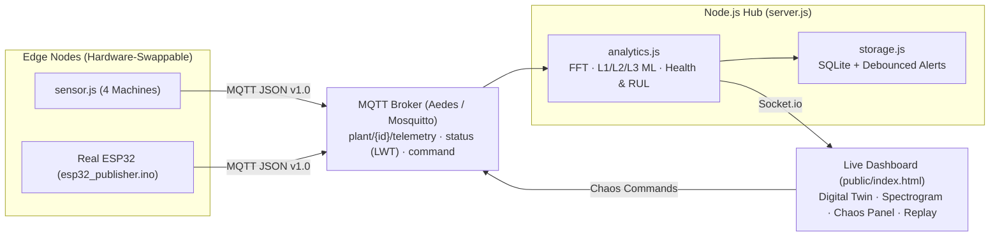

# Plant Condition Monitoring & Predictive Maintenance System

A hardware-swappable Node.js IoT platform featuring physically coupled multi-machine simulation, MQTT with Last Will & Testament (LWT), live server-side FFT & spectrogram, 3-layer anomaly detection (Thresholds → Z-Score/EWMA → Isolation Forest), RUL estimation, SQLite replay (1x–50x), and a live Digital Twin.

## Architecture



## Payload Schema (`schemaVersion: "1.0"`)
Published to `plant/<machineId>/telemetry` (identical for `sensor.js` and `esp32_publisher/esp32_publisher.ino`):
- `machineId`, `machineType`, `timestamp` (ISO-8601), `simHours`, `sampleRateHz` (512)
- `metrics`: `temperature` (°C), `current` (A), `rpm` (RPM), `load` (%), `process` (Nm/bar/m3h), `ambientTemp` (°C), `ambientHumidity` (%), `wear` (%)
- `vibrationSamples`: 256 raw floats sampled at 512 Hz

## Setup & Run

### Local (Zero external installs)
```bash
npm install
npm start            # Terminal 1 (starts embedded MQTT broker + web hub)
npm run sim          # Terminal 2 (starts 4 simulated machines)
```
Open **http://localhost:3000**.

### Docker Compose (with Eclipse Mosquitto)
```bash
docker compose up --build
```

### Tests & Evaluation
```bash
npm test             # Unit tests for FFT and anomaly detectors
npm run eval         # Precision, Recall & F1 against logs/ground_truth.jsonl
```

## 2-Minute Live Demo Script
1. **0:00–0:25 — Baseline & Digital Twin:** Open `http://localhost:3000`. Show the 4 spinning machines on the Digital Twin (`MOTOR-01 → PUMP-02 → COMP-04 → FAN-03`) and wait ~20s for the Isolation Forest badge to switch from `training` to `ML Score`.
2. **0:25–0:55 — Live FFT & Bearing Fault:** In the Chaos Panel, inject **Bearing Fault (BPFO)** on `MOTOR-01`. Point out the yellow peak jumping up at ~104 Hz on the FFT, the glowing horizontal stripe in the scrolling spectrogram, and **L3 (Isolation Forest)** catching it.
3. **0:55–1:25 — Cascading Fault & RUL:** Inject **Cascading Fault** on `MOTOR-01`. Watch `PUMP-02` overheat 2 seconds later, health scores drop, and the **RUL** display switch to a live countdown with a 95% confidence band.
4. **1:25–1:45 — MQTT LWT & Alert Workflow:** Click **Kill Node (LWT)** on `FAN-03`. Its rotor stops immediately as the broker fires its Last Will & Testament, logging a `CRITICAL` alert in the bottom table—click **Ack** then **Resolve**, and click **Revive Node**.
5. **1:45–2:00 — SQLite 25x Replay & Metrics:** Select **25x** in the top Replay bar and click **Replay Recorded Data** to scrub through the entire incident at high speed. Finish in the terminal with `npm run eval` to show live Precision/Recall/F1.